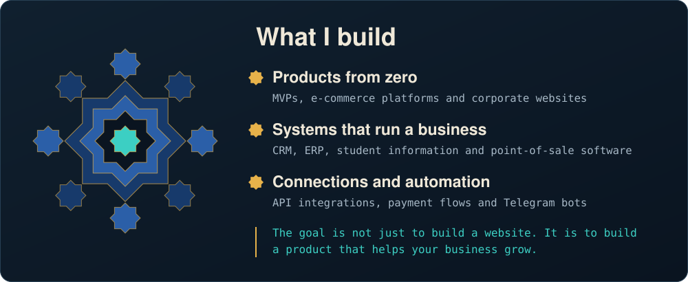
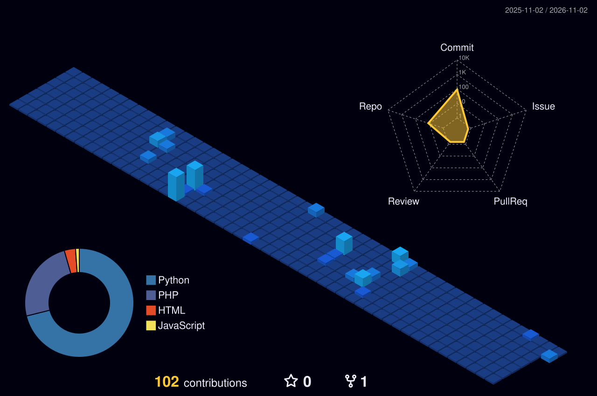
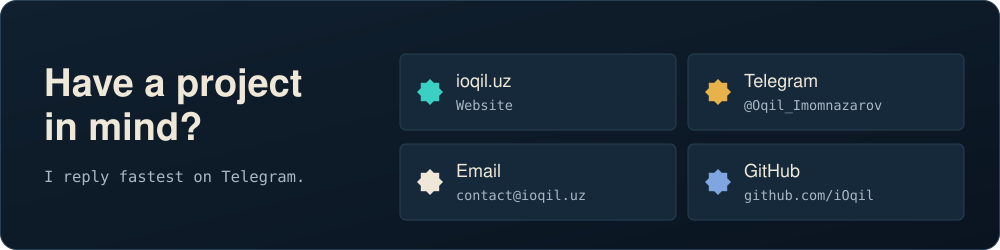

  

  

  

  

 

## Open source work

<table>
<tr><th>Project</th><th>What it is</th><th>Built with</th></tr>
<tr><td><a href="https://e-book.ioqil.uz"><b>Oqil E-books</b></a> <a href="https://github.com/iOqil/e-book">source</a></td><td>Programming books in Uzbek for complete beginners: 8 books, 297 diagrams, about 150 chapters</td><td><code>Python</code> <code>MkDocs</code></td></tr>
<tr><td><a href="https://github.com/iOqil/quran-tracker"><b>QuranTracker</b></a></td><td>Tracks Qur'an memorisation with progress statistics</td><td><code>React</code> <code>TypeScript</code> <code>Express</code> <code>Prisma</code> <code>MySQL</code></td></tr>
<tr><td><a href="https://github.com/iOqil/pos-backend"><b>POS backend</b></a></td><td>API for a point-of-sale system, with Swagger docs</td><td><code>PHP</code> <code>Laravel</code> <code>Sanctum</code></td></tr>
<tr><td><a href="https://github.com/iOqil/ioqilkonkursbot"><b>Contest bot</b></a></td><td>Telegram contest bot with a web panel</td><td><code>aiogram 3</code> <code>FastAPI</code> <code>MySQL</code> <code>Docker</code></td></tr>
<tr><td><a href="https://github.com/iOqil/refbot"><b>Referral bot</b></a></td><td>Telegram referral bot</td><td><code>aiogram 3</code> <code>SQLite</code> <code>Docker</code></td></tr>
<tr><td><a href="https://github.com/iOqil/Oqil.Rich-Editor"><b>Rich Editor</b></a></td><td>Text editor that runs in the browser</td><td><code>JavaScript</code> <code>SCSS</code></td></tr>
</table>

Most of my client work lives in private repositories. [See everything that is public](https://github.com/iOqil?tab=repositories).

### Every commit raises a building

  

  

  

